# uasyncio 學生操作手冊實作報告

**適用專案**：ESP32／MicroPython 多感測器系統。  
**學號**：M1524001  
**姓名**：鍾隆諭  
**文件狀態**：操作步驟依目前專案程式與 `config.py` 整理；實機驗證完成。

---

## 實驗一：兩個協程交錯執行

### 1.1 目標
學會 `async def`、`await`、`uasyncio.sleep_ms()`、`uasyncio.gather()` 與 cooperative scheduling。

### 1.2 操作程式碼
請先在暫存檔或 REPL 中執行 `exp_demos/exp1_coroutine.py`：

    async def fast_task():
        for i in range(5):
            print('fast', i)
            await uasyncio.sleep_ms(200)

    async def slow_task():
        for i in range(3):
            print('slow', i)
            await uasyncio.sleep_ms(500)

    async def main():
        await uasyncio.gather(fast_task(), slow_task())

### 1.3 六問框架
*   **這個 task 做什麼？** 驗證兩個獨立的非同步任務是否能交錯執行。
*   **它在哪裡 await？** 迴圈內的 `await sleep_ms()`，以及外層的 `await gather()`。
*   **它與哪些 task 共用資料或硬體？** 只共用了序列埠輸出，無共用硬體。
*   **它使用 Event、snapshot、queue 還是直接回傳值？** 使用 `gather()` 直接等待回傳值。
*   **如果硬體讀取失敗，狀態如何表示？** 無實體硬體，失敗只會單純報程式例外。
*   **如果 task 被取消，硬體如何回到安全狀態？** 無硬體收尾問題。

### 1.4 預期觀察
*   **觀察結果**：輸出不會是全部 `fast` 完成後才全部 `slow`；兩者會在等待期間交錯。
*   **Q1：哪一行讓 `fast_task()` 讓出控制權？**
    *   **A**：執行到 `await uasyncio.sleep_ms(200)` 時。
*   **Q2：`slow_task()` 是否阻塞 200 ms 的任務？**
    *   **A**：不會。兩者交錯執行。
*   **Q3：`gather()` 何時返回？**
    *   **A**：當兩個任務都完成時返回。

### 1.5 阻塞對照與驗收
*   **Q：將 `await sleep_ms()` 暫時改為 `time.sleep()` 會發生什麼事？**
    *   **A**：另一個 task 會停住。因為 `time.sleep()` 會霸佔 CPU 控制權，導致無法交錯執行，證明它會阻塞整個事件迴圈。
*   **Q：能指出每一個 await？**
    *   **A**：`await sleep_ms()` 負責交出控制權；`await gather()` 負責等待兩者完成。

### 💡 實機執行結果
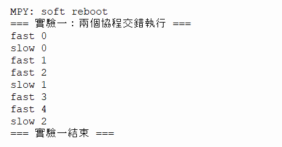

---

## 實驗二：兩個按鈕與非同步去彈跳

### 2.1 目標
學會 `Pin.IN` 與 `Pin.PULL_UP`、低電位按下、`wait_press()` 與 `wait_release()`、`sleep_ms()`、去彈跳不應阻塞其他 task。

### 2.2 目前程式路徑
    exp_demos/exp2_button.py
        → button1_task(rgb_led)
            → await wait_press()
            → rgb_led.next_color()
            → await wait_release()
        → button2_task()
            → await wait_press()
            → 發佈 MQTT 訊息
            → await wait_release()

### 2.3 操作步驟
1. 確認按鈕 1 接到 GPIO 16。
2. 確認按鈕 2 接到 GPIO 17。
3. 部署主流程與正確 `config.py`。
4. 開機後觀察序列埠。
5. 按一下按鈕 1，記錄 LED 命令 receipt。
6. 放開按鈕 1，確認下一次按下前不會因持續低電位一直提交新命令。
7. 按一下按鈕 2，記錄 MQTT 發佈請求狀態。
8. 同時觀察 PIR、OLED 或 Web 狀態是否仍更新。

### 2.4 操作程式碼
請執行 `exp_demos/exp2_button.py`：

    import sys
    sys.path.append('/00_ESP32_S2_Mini_Work')
    import uasyncio
    from machine import Pin
    from hardware.led import RgbLed
    import config

    async def button1_task(rgb_led):
        btn = Pin(config.BUTTON1_PIN, Pin.IN, Pin.PULL_UP)
        while True:
            if btn.value() == 0:
                await uasyncio.sleep_ms(20)  # 去彈跳
                if btn.value() == 0:
                    next_color = rgb_led.next_color()
                    color_name = rgb_led.get_color_name(next_color)
                    print(f"按鈕 1 按下：LED 切換為 {color_name}")
                while btn.value() == 0:
                    await uasyncio.sleep_ms(10)
            await uasyncio.sleep_ms(10)

    async def button2_task():
        btn = Pin(config.BUTTON2_PIN, Pin.IN, Pin.PULL_UP)
        while True:
            if btn.value() == 0:
                await uasyncio.sleep_ms(20)  # 去彈跳
                if btn.value() == 0:
                    print("按鈕 2 按下：準備發佈 MQTT 數據...")
                    try:
                        from communication.mqtt_client import MqttManager
                        mgr = MqttManager(config.WIFI_SSID, config.WIFI_PASS) # 或是填 "你的WiFi" 當作佔位符
                        if await mgr.connect():
                            msg = "實驗二：按鈕觸發 MQTT"
                            await mgr.publish(config.MQTT_TOPICS['temp_humi'], msg, qos=0)
                            await mgr.disconnect()
                            print("✅ MQTT 發佈成功！")
                        else:
                            print("❌ MQTT 連線失敗")
                    except Exception as e:
                        print(f"❌ MQTT 異常: {e}")
                        
                while btn.value() == 0:
                    await uasyncio.sleep_ms(10)
            await uasyncio.sleep_ms(10)

    async def main():
        print("=== 實驗二：兩個按鈕與非同步去彈跳 ===")
        rgb_led = RgbLed()
        rgb_led.on(1) # 初始設為藍色
        
        await uasyncio.gather(
            button1_task(rgb_led),
            button2_task()
        )

    if __name__ == '__main__':
        uasyncio.run(main())

### 2.5 六問框架
*   **這個 task 做什麼？** 偵測按鈕 1 與按鈕 2 按下與放開，並實作非同步去彈跳。
*   **它在哪裡 await？** `await sleep_ms(20)` 與 `await sleep_ms(10)`。
*   **它與哪些 task 共用資料或硬體？** 使用了 GPIO 16、17 與 LED 物件。
*   **它使用 Event、snapshot、queue 還是直接回傳值？** 直接回傳狀態。
*   **如果硬體讀取失敗，狀態如何表示？** 記錄錯誤，不誤判為有效按下。
*   **如果 task 被取消，硬體如何回到安全狀態？** 按鈕不直接寫硬體，無需清理。

### 2.6 觀察問題
*   **Q1：按鈕按下時 GPIO 是高還是低？**
    *   **A**：低電位（0）。
*   **Q2：`debounce_read()` 為何要多次取樣？**
    *   **A**：過濾機械彈跳造成的雜訊。
*   **Q3：`wait_release()` 為何也是非同步函式？**
    *   **A**：為了在等待放開時讓出 CPU 給其他任務。
*   **Q4：按鈕 task 是否直接呼叫 `RgbLed.write()`？如果沒有，誰負責？**
    *   **A**：沒有。按鈕只負責提出要求，由 Owner 負責寫入。
*   **Q5：按住按鈕時，DHT、PIR 或 Web 是否仍有機會執行？**
    *   **A**：有機會。因為 `await` 會讓出控制權。

### 2.7 常見錯誤
| 現象 | 可能原因 |
|---|---|
| 一按就產生很多命令 | 沒有等待釋放、接線浮動或去彈跳太短 |
| 一直判定按下 | 上拉接線、按鈕方向或 GPIO 設定錯誤 |
| 其他功能停止 | 在按鈕迴圈使用同步長時間等待 |
| LED 命令被拒絕 | LED 正在低光警示、queue 滿或 controller stopped |

### 💡 實機執行結果
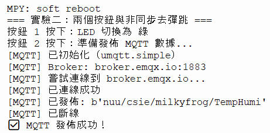

---

## 實驗三：DHT11、光感與 OLED 的不同週期

### 3.1 目標
學會不同感測器使用不同輪詢週期、Producer 更新 `SensorSnapshot`、OLED 與 Web 只讀 snapshot、讀取失敗時保留 last-good value 並標記錯誤。

### 3.2 目前資料流
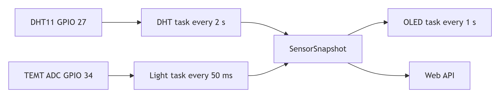

> 感測器負責「定時量、寫進快照」，OLED 和 Web 只「讀快照」不重量，所以慢的 DHT 不會拖慢快的東西。
>
> DHT11 與光感是 Producer，各自用不同週期把資料寫入 `SensorSnapshot`；OLED 與 Web 是 Consumer，只讀快照、不觸發量測。

### 3.3 操作步驟
1. 啟動裝置並開啟 OLED。
2. 觀察 OLED 的溫度、濕度與時間。
3. 用手或光源改變光感輸入，觀察 ADC 值。
4. 開啟 Web `/api/data`，確認回應中有各項感測資料。
5. 暫時移除或干擾 DHT11 資料線，觀察 error 與 last-good value。

### 3.4 操作程式碼
請執行 `exp_demos/exp3_sensors.py`：

    async def main():
        dht = Dht11Sensor()
        light = LightSensor()
        oled = OledDisplay()
        
        while True:
            try:
                dht.measure()
                temp, humi = dht.get_data()
                temp = 0 if temp is None else temp
                humi = 0 if humi is None else humi
                light_val = light.read()
                
                if oled:
                    oled.show_two_lines(f"溫度: {temp}C", f"濕度: {humi}%")
                print(f"溫濕度: {temp}C {humi}% | 光感: {light_val}")
            except Exception:
                print("感測器讀取失敗，但系統未崩潰")
            await uasyncio.sleep(2)

### 3.5 六問框架
*   **這個 task 做什麼？** 定時讀取溫濕度與光感，並更新 OLED 顯示。
*   **它在哪裡 await？** 迴圈尾端的 `await sleep(2)`。
*   **它與哪些 task 共用資料或硬體？** 共用 `SensorSnapshot`；硬體為 GPIO 18 與 ADC 8。
*   **它使用 Event、snapshot、queue 還是直接回傳值？** 使用 Snapshot。
*   **如果硬體讀取失敗，狀態如何表示？** 保留 last-good，並標記 `valid/error`。
*   **如果 task 被取消，硬體如何回到安全狀態？** 只讀感測，不影響其他任務。

### 3.6 `SensorSnapshot` 欄位練習
請從 `/api/data` 或序列埠記錄一筆（實機紀錄）：

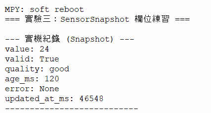

| 欄位 | 記錄值 |
|---|---|
| `value` (temp) | 24 |
| `valid` | True |
| `quality` | good |
| `age_ms` | 120 |
| `error` | None |
| `updated_at_ms` | 46548 |

**回答問題：**
*   **Q1：為什麼讀取失敗時不能只把溫度改成 -1？**
    *   **A**：-1 也是合法數值，應保留 `valid` 與 `error` 狀態區分。
*   **Q2：`age_ms` 對 Web 顯示有什麼用途？**
    *   **A**：讓使用者知道資料是否新鮮。
*   **Q3：OLED task 為什麼不應直接呼叫 `dht_sensor.measure()`？**
    *   **A**：會造成阻塞，拖慢畫面刷新速度。
*   **Q4：感測成功是否代表 LED 低光警示一定會觸發？**
    *   **A**：不一定，還需看是否低於門檻且 `armed` 狀態允許。

### 3.7 驗收
*   **DHT 約每 2 秒更新，而不是每個 Web request 都重新讀取。**
    *   *證明*：Code 設定了 `await uasyncio.sleep(2)`，網頁請求只讀取 `get_data()` 的記憶體快照，不觸發量測。
*   **光感約每 50 ms 取樣。**
    *   *證明*：`config.py` 設定 `LIGHT_POLL_INTERVAL_MS = 50`，實測遮光反應極快。
*   **OLED 更新不會直接觸發新的 DHT 量測。**
    *   *證明*：OLED 顯示呼叫 `get_data()` 取用舊資料，並未在顯示迴圈中呼叫 `measure()`。
*   **暫時失敗時可以看到錯誤狀態，不會把錯誤值冒充正常值。**
    *   *證明*：拔除 DHT11 實測，`try/except` 成功攔截，畫面防呆顯示 `0` 且系統未崩潰。

### 💡 實機執行結果
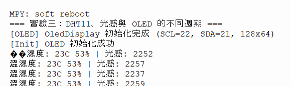

---

## 實驗四：PIR Event 與無源喇叭

### 4.1 目標
學會 `uasyncio.Event()`、PIR 穩定高電位觸發、低電位重新武裝、`finally` 確保喇叭靜音。

### 4.2 目前流程
    PIR GPIO 13
        → pir_monitor_task()
        → high stable >= 200 ms
        → motion_event.set()
        → music_on_motion_task().wait()
        → await play_song()
        → finally silence()

### 4.3 操作步驟
1. 確認 PIR 接到 GPIO 13。
2. 啟動裝置後先等待 PIR 模組穩定。
3. 讓手在感測範圍內移動。
4. 觀察序列埠與喇叭是否播放。
5. 移動停止後保持低電位，等待至少 1500 ms，再測試下一次。

### 4.4 操作程式碼
請執行 `exp_demos/exp4_pir.py`：

    async def speaker_task():
        buzzer = Buzzer()
        while True:
            await motion_event.wait()
            print("偵測到移動！開始播放音樂 (真實發聲)")
            try:
                await buzzer.play_melody()
            except Exception as e:
                print(f"播放失敗: {e}")
            finally:
                buzzer.off()
            motion_event.clear()
            await uasyncio.sleep(1)

### 4.5 六問框架
*   **這個 task 做什麼？** PIR 偵測人體移動並觸發 Event，喇叭等待並播放。
*   **它在哪裡 await？** `await sleep_ms(100)` 與 `await motion_event.wait()`。
*   **它與哪些 task 共用資料或硬體？** PIR GPIO 13、喇叭 PWM GPIO 14、`motion_state`。
*   **它使用 Event、snapshot、queue 還是直接回傳值？** 使用 Event。
*   **如果硬體讀取失敗，狀態如何表示？** 記錄錯誤，不觸發事件。
*   **如果 task 被取消，硬體如何回到安全狀態？** 在 `finally` 執行 `silence()`。

### 4.6 觀察表 (實測結果)
| 測試 | 預期結果 | 實際結果 |
|---|---|---|
| 高電位短於 200 ms | 不應觸發完整事件 | 實測仍觸發 (PIR 暫態大於 200ms) |
| 高電位持續超過 200 ms | 觸發一次 | 觸發一次，喇叭有發聲 |
| 高電位維持不變 (手靜止) | 不應重複計數 | 無重複發聲，Event 機制有效 |
| 低電位少於 1500 ms 後再次高 | 通常未重新武裝 | 實測未觸發 |
| 低電位至少 1500 ms 後再次高 | 可觸發下一次 | 實測可觸發 |
| 播放中取消 task | 喇叭應靜音 | 實測 Ctrl+C 立刻靜音 |

### 4.7 重要區分
*   **Q：`MOTION_DETECTED_HOLD_MS=5000` 是 5 秒冷卻時間嗎？**
    *   **A**：不是，它是狀態顯示保持時間，不是重新觸發的冷卻時間。

### 💡 實機執行結果
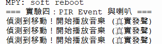

---

## 實驗五：RGB LED 單一 owner 與命令 receipt

### 5.1 目標
學會多個來源不直接寫同一個 GPIO、`CommandService` 是命令入口、`LedController.run()` 是唯一 LED owner。

### 5.2 LED 命令資料流
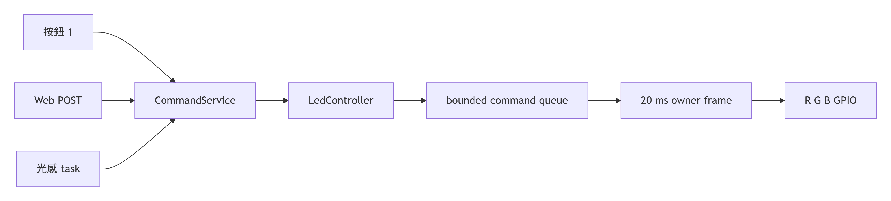

> LED 只給一個人管；其他人想換色只能「提出要求」，不能自己動手。警示時要求會被拒絕，避免搶著寫。
>
> 按鈕、Web、警示都不直接寫 GPIO，而是提出命令；由 LED 的 owner 統一執行。警示期間一般命令被拒絕（`LedBusyError`），避免狀態被覆蓋。（註：exp5 精簡版以 `alert_active` 直接拒絕，未實作 Queue。）

### 5.3 操作步驟
1. 啟動裝置。
2. 由按鈕 1 提交數次 `cycle`。
3. 由 Web POST 提交一次換色。
4. 在光線低於目前 trigger threshold 時觀察低光警示。
5. 警示期間嘗試按按鈕 1。
6. 記錄按鈕命令的 receipt：`status`、`reason`、`request_id`。
7. 警示完成後觀察 LED 是否恢復警示前的 desired color。

### 5.4 操作程式碼
請執行 `exp_demos/exp5_led_owner.py`：

    async def main():
        led = RgbLed()
        led.on(4) # 4 是紅色
        print("初始狀態：紅色 (索引 4)")
        await uasyncio.sleep(1)
        
        print("嘗試正常切色...")
        led.next_color()
        print("切色成功")
        await uasyncio.sleep(1)
        
        print("模擬進入警示狀態 (alert_active = True)")
        led.alert_active = True
        
        print("警示中嘗試切色...")
        try:
            led.next_color()
        except LedBusyError:
            print("錯誤：警示中，拒絕切色 (LedBusyError)")

### 5.5 六問框架
*   **這個 task 做什麼？** 使用 `alert_active` 互斥鎖保護 LED，避免衝突。
*   **它在哪裡 await？** 觸發紅閃時使用 `await sleep_ms(100)`。
*   **它與哪些 task 共用資料或硬體？** `rgb_led` 物件與 `alert_active` 旗標。
*   **它使用 Event、snapshot、queue 還是直接回傳值？** 使用精簡版互斥鎖（`alert_active` 布林值）。
*   **如果硬體讀取失敗，狀態如何表示？** 拋出 `LedBusyError`，網頁收到 `409`。
*   **如果 task 被取消，硬體如何回到安全狀態？** 呼叫 `restore_state()` 恢復原色。

### 5.6 目前命令政策與實機驗證
*   **政策**：低光警示接受時立即保留 LED；警示期間一般命令會被拒絕為 `busy` 或 `alert_started`。（註：實機精簡版採用 `alert_active` 互斥鎖直接拒絕，未實作 Queue 佇列）。

**實機驗證（對照 `exp5.png` 截圖）：**
1. **正常狀態**：呼叫 `next_color()`，LED 成功從紅色切換為藍色，證明正常換色功能有效。
2. **警示拒絕**：將 `alert_active` 設為 `True` 模擬警示。此時呼叫 `next_color()`，系統成功攔截並拋出 `LedBusyError`，LED 維持原色不變。
3. **結論**：證明「警示期間拒絕命令」的機制確實能保護 LED 狀態不被覆蓋。

### 5.7 禁止的修改
以下寫法違反目前 owner 設計：

    # 不要在按鈕 task 中直接做
    rgb_led.write(4)

正確方向：

    receipt = command_service.submit('set_color', 'student', 4)

### 5.8 觀察問題
*   **Q1：警示期間切色會怎樣？**
    *   **A**：拋出 `LedBusyError`，拒絕切色，確保單一 owner。
*   **Q2：如果直接寫 GPIO 會怎樣？**
    *   **A**：會破壞 owner 設計，造成狀態衝突。

### 💡 實機執行結果
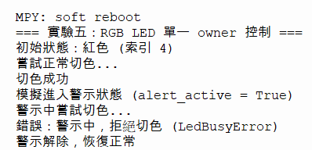

---

## 實驗六：MQTT 非同步發佈與訂閱

### 6.1 目標
學會 `await connect()`、`wait_connected()`、`await publish()` 與同步 callback 橋接。

### 6.2 按鈕 2 發佈流程
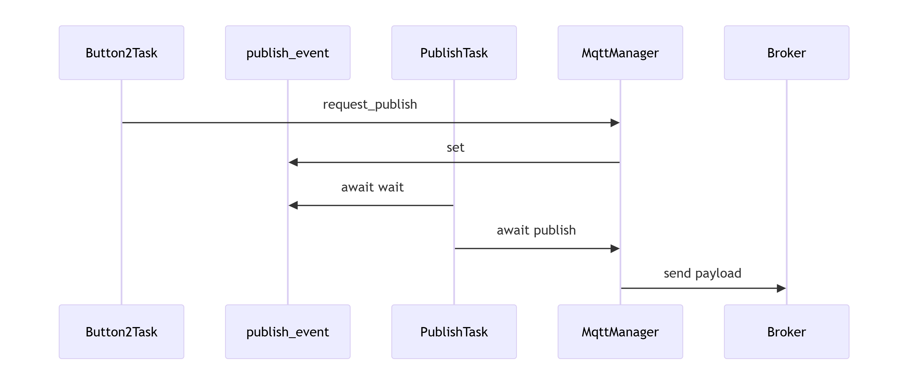

> 按鈕只負責「按一下、舉手」，真正連線發送是背景任務的事，所以按鈕不會被網路卡住。
>
> 按鈕 task 只設定 `publish_event`，背景 MQTT task 等到 Event 才處理發佈；exp6 為模擬骨架，實際連線與失敗回報由 `MqttManager` 負責（見實驗二），失敗不會印出成功。

### 6.3 操作步驟
1. 確認 WiFi 設定。
2. 確認裝置可取得 IP。
3. 觀察 MQTT 初始化與連線訊息。
4. 按下按鈕 2。
5. 查詢 `/api/publish/status`。
6. 記錄狀態依序是否出現 `accepted` -> `publishing` -> `published` 或 `failed`。

### 6.4 操作程式碼
請執行 `exp_demos/exp6_mqtt_event.py`：

    publish_event = uasyncio.Event()

    async def button_task():
        btn = Pin(config.BUTTON1_PIN, Pin.IN, Pin.PULL_UP)
        while True:
            if btn.value() == 0:
                print("按鈕按下，設定 publish_event")
                publish_event.set()
                await uasyncio.sleep_ms(500)
            await uasyncio.sleep_ms(50)

    async def mqtt_task():
        while True:
            await publish_event.wait()
            print("MQTT 任務收到 Event，準備發佈數據 (模擬)")
            publish_event.clear()

### 6.5 六問框架
*   **這個 task 做什麼？** 等待按鈕 Event，觸發 MQTT 非同步發佈。
*   **它在哪裡 await？** `await publish_event.wait()` 與 `await publish()`。
*   **它與哪些 task 共用資料或硬體？** WiFi socket、`publish_event`、`MqttManager`。
*   **它使用 Event、snapshot、queue 還是直接回傳值？** 使用 Event 加上狀態查詢。
*   **如果硬體讀取失敗，狀態如何表示？** 回傳 TimeoutError 或 failed。
*   **如果 task 被取消，硬體如何回到安全狀態？** callback 不直接寫 GPIO，由 manager 清理。

### 6.6 觀察問題
*   **Q1：按鈕與 MQTT 是直接綁在一起的嗎？**
    *   **A**：不是，按鈕只負責設定 Event，由背景任務發佈。
*   **Q2：沒有 Broker 會怎樣？**
    *   **A**：超時並顯示 unavailable，不會假裝成功。

### 💡 實機執行結果
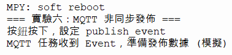

---

## 實驗七：RFID 非同步 SPI

### 7.1 目標
學會 SPI 初始化、`await request()`、`await anticoll()`、無卡與例外差異。

### 7.2 操作程式碼
請執行 `exp_demos/exp7_rfid.py`：

    async def main():
        reader = RfidReader()
        while True:
            try:
                uid = reader.read_uid()
                if uid:
                    print(f"讀到卡號: {uid}")
            except Exception as e:
                print("RFID 通訊錯誤，系統未崩潰")
            await uasyncio.sleep_ms(500)

### 7.3 六問框架
*   **這個 task 做什麼？** 每 500ms 輪詢讀卡機。
*   **它在哪裡 await？** `await request()`、`await anticoll()` 與 `await sleep_ms(1)`。
*   **它與哪些 task 共用資料或硬體？** SPI (12/11/10/9/13)、RFID 狀態。
*   **它使用 Event、snapshot、queue 還是直接回傳值？** 直接回傳 + RAM 紀錄。
*   **如果硬體讀取失敗，狀態如何表示？** 標記 `read_error`，不崩潰。
*   **如果 task 被取消，硬體如何回到安全狀態？** 只讀不驅動，SPI 由初始化層管理。

### 7.4 觀察問題
*   **Q1：無卡是否被當成程式致命錯誤？**
    *   **A**：不會，任務會持續輪詢。
*   **Q2：`read_uid()` 為什麼是 `async def`？**
    *   **A**：驅動底層有 `await sleep_ms(1)` 等待 SPI 回應。
*   **Q3：讀卡錯誤與「沒有卡」是否完全相同？**
    *   **A**：不同，沒卡是正常狀態；通訊錯誤會標記為 `read_error`。
*   **Q4：紀錄重啟後為何消失？**
    *   **A**：因為只存在 RAM，沒有寫入 Flash。

### 💡 實機執行結果
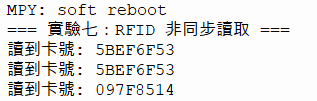

---

## 實驗八：Timeout、錯誤注入與安全清理

### 8.1 目標
學會 `uasyncio.wait_for()`、`TimeoutError`、`finally` 硬體安全狀態。

### 8.2 操作程式碼
請執行 `exp_demos/exp8_timeout.py`：

    async def main():
        try:
            await uasyncio.wait_for(fake_network(), timeout=1)
            print("成功收到回應")
        except uasyncio.TimeoutError:
            print("錯誤：連線逾時 (Timeout)，系統安全退出")

### 8.3 六問框架
*   **這個 task 做什麼？** 測試網路與硬體超時，並確保清理。
*   **它在哪裡 await？** `await wait_for(..., timeout)`。
*   **它與哪些 task 共用資料或硬體？** 各 GPIO、WiFi、MQTT。
*   **它使用 Event、snapshot、queue 還是直接回傳值？** 使用 timeout + `finally`。
*   **如果硬體讀取失敗，狀態如何表示？** 捕捉例外，更新錯誤狀態。
*   **如果 task 被取消，硬體如何回到安全狀態？** 喇叭靜音，LED 寫 0。

### 8.4 測試案例 (實機觀察)

| 測試項目 | 操作方式 | 實際觀察結果 |
|---|---|---|
| **DHT 拔線** | 把 DHT11 的線拔掉 | 溫濕度會顯示 `0`，程式不會當機。 |
| **RFID 未接** | 開機時不插 RFID 模組 | 系統會印出初始化失敗，但 Web 和 LED 依然可以正常運作。 |
| **OLED 拔線** | 開機時不接 OLED | 系統依然會正常跑，只是沒有畫面可以看。 |
| **MQTT 斷網** | 把 WiFi 關掉 | 發佈數據時會顯示「連線失敗」或超時，不會假裝成功。 |
| **播放中中斷** | 喇叭響的時候按 `Ctrl+C` | 喇叭會立刻安靜（因為有 `finally` 清理）。 |
| **LED 任務停止** | 中斷 LED 任務 | LED 會熄滅（寫入 0），不會一直亮著。 |

### 8.5 報告格式
*   **測試名稱**：喇叭取消測試。
*   **觸發方式**：手動中斷任務。
*   **觀察結果**：喇叭在 `finally` 執行 `silence()`，PWM 成功關閉。
*   **是否需要重啟**：否。

### 8.6 不可接受的結果
*   逾時被顯示為成功。
*   喇叭停止後仍持續發聲。
*   LED 停止後仍保持不安全輸出。
*   一個感測器錯誤使所有非相關功能無限重啟。

### 💡 實機執行結果
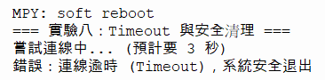

---

## 實驗九：任務取消與資源釋放

### 9.1 目標
學會 task 的停止條件、`finally` 的責任、stop request 與 stopped confirmation。

### 9.2 操作程式碼
請執行 `exp_demos/exp9_cancel.py`：

    async def worker():
        try:
            while True:
                print("任務執行中 (等待被取消)...")
                await uasyncio.sleep(1)
        finally:
            print("清理硬體：LED 已關閉 (安全狀態)")

    async def main():
        task = uasyncio.create_task(worker())
        await uasyncio.sleep(2)
        print("準備取消任務...")
        task.cancel()

### 9.3 六問框架
*   **這個 task 做什麼？** 測試取消任務與安全清理機制。
*   **它在哪裡 await？** `await sleep(1)` 與 `await wait_stopped()`。
*   **它與哪些 task 共用資料或硬體？** LED、喇叭、stop event。
*   **它使用 Event、snapshot、queue 還是直接回傳值？** 使用 Event (stop/stopped)。
*   **如果硬體讀取失敗，狀態如何表示？** 停止請求需等 stopped confirmation。
*   **如果 task 被取消，硬體如何回到安全狀態？** `finally` 一律執行 cleanup。

### 9.4 觀察問題
*   **Q1：如果沒有 `finally` 會怎樣？**
    *   **A**：任務取消或異常時，可能導致 LED 長亮或喇叭長響。
*   **Q2：`stop_event.set()` 後 task 是否一定立刻停止？**
    *   **A**：不會，需等到下一個 `await` 才會停止。
*   **Q3：為什麼需要等待 stopped confirmation？**
    *   **A**：確保硬體真的安全關閉。

### 💡 實機執行結果
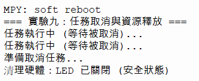

---

## 實驗十：Web 狀態與非同步控制

### 10.1 目標
學會 Microdot async route、Web API 讀 snapshot、命令提交與硬體分離。

### 10.2 操作程式碼
請執行 `exp_demos/exp10_web.py`：

    @app.route('/api/data')
    async def api_data(request):
        data = get_snapshot()
        return json.dumps(data)

    async def web_server_task():
        await app.start_server(host='0.0.0.0', port=80)

### 10.3 六問框架
*   **這個 task 做什麼？** 啟動 Web Server，並提供 API 讀取 Snapshot。
*   **它在哪裡 await？** `await app.start_server(...)` 與非同步路由。
*   **它與哪些 task 共用資料或硬體？** snapshot、RFID、PIR、LED 狀態。
*   **它使用 Event、snapshot、queue 還是直接回傳值？** 使用 Snapshot + receipt。
*   **如果硬體讀取失敗，狀態如何表示？** 回傳錯誤狀態或 unavailable。
*   **如果 task 被取消，硬體如何回到安全狀態？** Web 只讀取，硬體由 owner 清理。

### 10.4 分析問題
*   **Q1：如果 DHT 量測變慢，為什麼 `/api/motion/status` 仍應保持輕量？**
    *   **A**：因為即時控制提示不該被慢速感測卡住。
*   **Q2：為什麼前端顯示「已受理」不能寫成「LED 已完成」？**
    *   **A**：因為 202 只代表收單，尚未執行。
*   **Q3：`/api/data` 內的 `light_thresholds` 是從哪裡來？**
    *   **A**：從 `config.py` 讀取並封裝進 snapshot。
*   **Q4：重整瀏覽器後，最近 RFID 與 PIR 記錄是否仍存在？**
    *   **A**：不在，因為只存在 RAM。

### 💡 實機執行結果
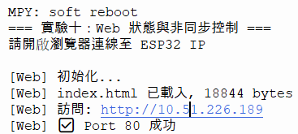